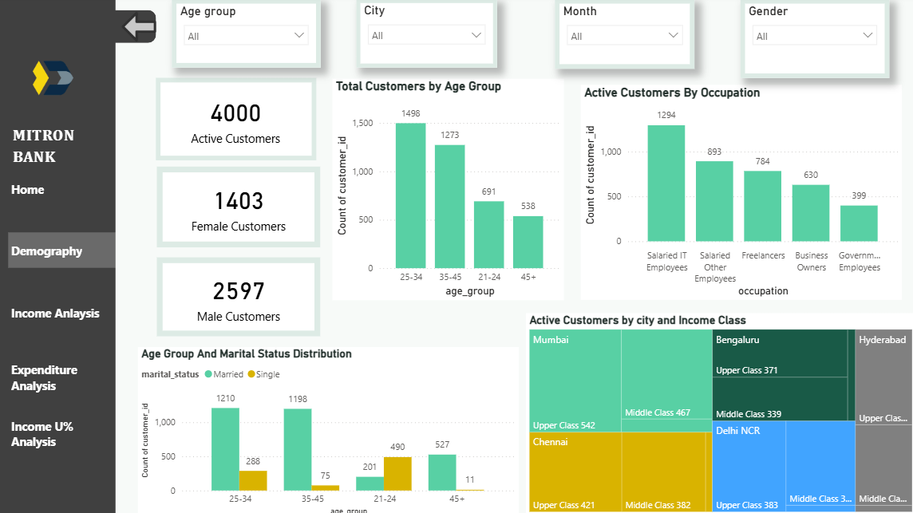
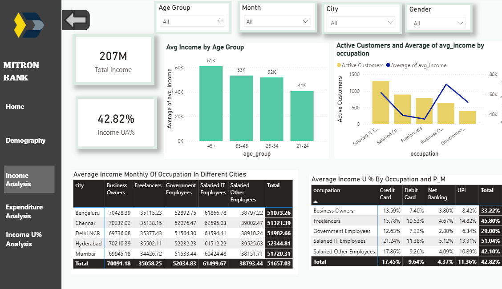
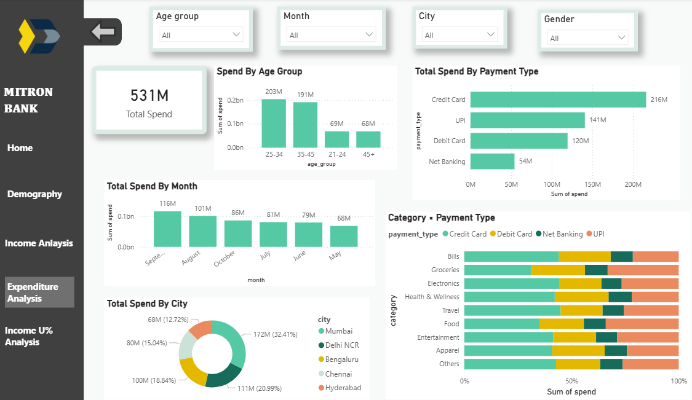
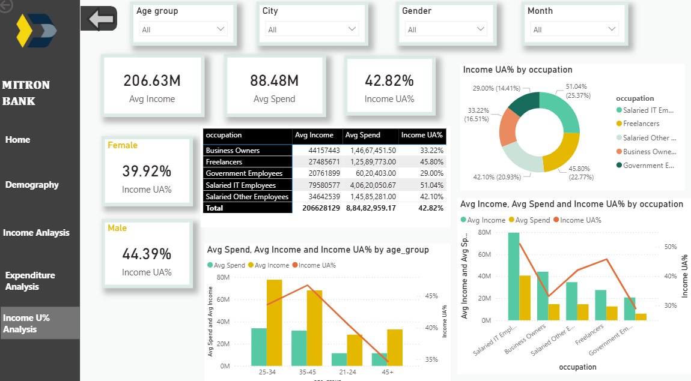

# Mitron Bank Power BI Dashboard

## Overview
An interactive Power BI dashboard exploring customer demographics, income, expenditure, and income utilization to support analysis for Mitron Bank's proposed credit card offering.

## Dashboard Pages
- **Demography:** Customer distribution by age group, gender, occupation, marital status, city, and income class.
- **Income Analysis:** Income by age group and occupation, monthly income across cities, and income utilization by occupation and payment method.
- **Expenditure Analysis:** Spending by age group, month, city, category, and payment type.
- **Income Utilization:** Comparison of average income and spending, with utilization breakdowns by gender, age group, and occupation.

## Tools Used
- Microsoft Power BI
- CSV datasets

## Interactive Filters
- Age group
- Month
- City
- Gender

## Key Metrics
The report includes customer counts, total and average income, total and average spending, and income utilization percentage. Values may change depending on the selected filters.

## How to View
1. Download `mitron_bank.pbix` from this repository.
2. Open it in Microsoft Power BI Desktop.
3. If prompted, reconnect the report to the required source dataset files.
4. Use the filters to explore the report.

## Dashboard Preview

## Dashboard Preview

### Home

### Demography

### Income Analysis

### Expenditure Analysis

### Income Utilization

## Author
**Akshata Basanagoud Biradar**  
B.Tech, Artificial Intelligence & Data Science  
D. Y. Patil College of Engineering, Akurdi, Pune
